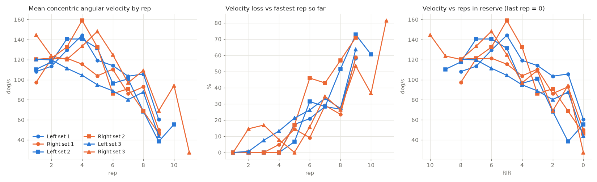
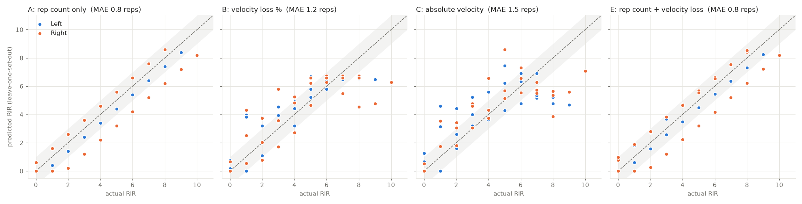
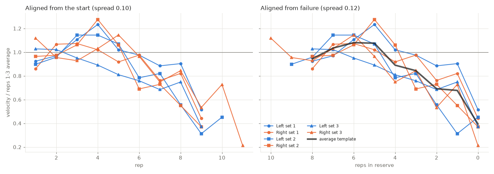
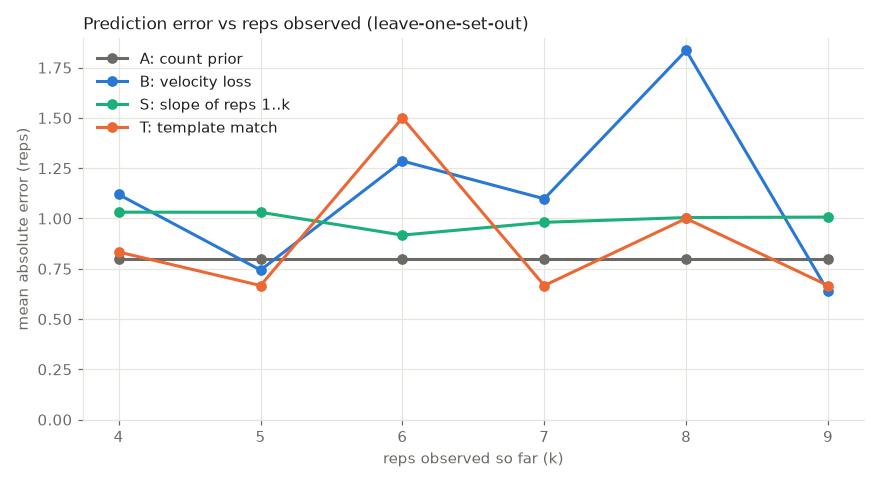
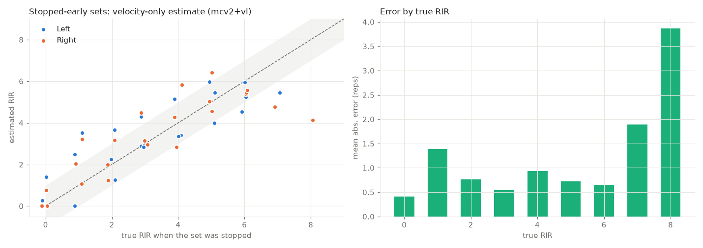
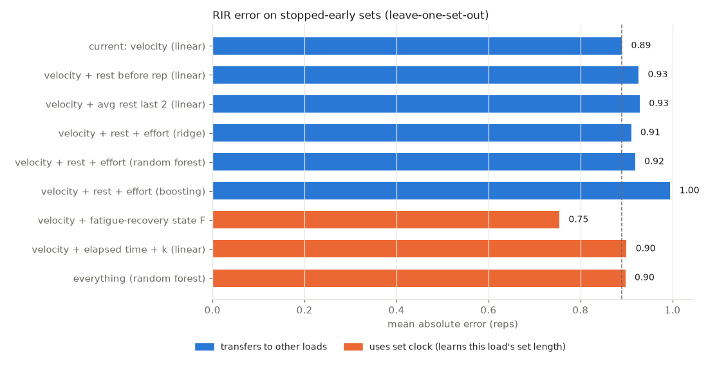

# Velocity-based analysis of dumbbell curls (IMU on the dumbbell)

**Data:** 6 sets of dumbbell biceps curls taken to failure, 3 per arm, alternating
L/R: test1 L, test2correct R, test3 L, test4 R, test5 L, test6 R. test2 was
incomplete and is excluded. The LSM6DS3 IMU was strapped to the dumbbell and
sampled at 103 Hz, with no dropped samples.

**To reproduce:** run `.venv/bin/python analysis/analyze_curls.py`. Figures and
tables are written to `analysis/output/`.

## Headline results

| | |
|---|---|
| Reps detected | **L: 9, 10, 9 · R: 9, 9, 11**. Every set ends with one extra *failed* attempt (stalls at 30–90° and is lowered). |
| Early-set speed (reps 1–3) | 121 °/s mean concentric angular velocity; **≈ 0.34 m/s** dumbbell speed; 1.3 s concentric |
| Last successful rep | 47 °/s (range 28–60); **≈ 0.18 m/s**; 3.8 s concentric |
| Velocity loss at the last rep | 58–82 % (mean 66 %) |
| Best single velocity cue | velocity loss vs RIR, r = −0.85 |
| RIR estimation error (leave-one-set-out) | count-only 0.8 reps · velocity-loss-only 1.2 reps · count + velocity 0.8 reps |

**Yes**, later reps are much slower, the rep count can be detected reliably,
and velocity loss tracks reps in reserve. On *this* dataset, though, counting
reps predicts RIR as well as velocity does. That's because every set used the
same load and lasted 9–11 reps. Velocity becomes the more useful signal when
load, day or fatigue changes and you no longer know how many reps a set "should"
last. See "Limitations".

## 1. How the signal was processed

1. **Orientation.** A curl rotates the dumbbell about the sensor's Z axis. This
   was checked: the gravity-derived tilt rate equals −gz with slope 1.009 and
   r = 0.96, which also confirms the gyro's scale. A complementary filter fuses
   the integrated gyro with gravity tilt (τ = 1 s) to give the dumbbell angle.
   0° is the bottom of the curl and about 170° is the top.
2. **Lift direction.** The bottom is taken as the extreme nearest the rest
   position. This was cross-checked in every set: the accelerometer-derived
   vertical velocity during the "lift" phase is positive.
3. **Rep segmentation.** A lift *attempt* starts when the angle rises above 40°
   and ends when it falls below 25°. The concentric phase runs from motion onset
   (ω > 10 °/s) to the top, and **includes sticking-point pauses**. A first
   version split at the pauses and miscounted the hardest reps. An attempt is
   **full** if its ROM is ≥ 70 % of the set median. A slow or stalled attempt
   after the last full rep is **failed**. A quick movement after the set
   (putting the dumbbell down) is **handling**.
4. **Velocity**, three ways:
   - **Angular** mean and peak concentric velocity, straight from the gyro.
     This needs no integration and doesn't drift, so it is **the primary metric**.
   - **Linear (accelerometer):** gravity removed using the orientation, rotated
     into the vertical plane, and integrated over each concentric phase with
     zero velocity forced at both turnarounds.
   - **Linear (ω × r, r = 0.33 m):** about 2× higher than the accelerometer value.
     The dumbbell rotates more than the elbow does because the wrist flexes
     during the curl (median ROM 170°, against roughly 140° for the elbow).
     The *effective* radius from the data is only 0.17 m. Don't use ω × r for
     absolute m/s.

Per-trial plots in `output/trial_*.png` show the angle, angular velocity and
vertical velocity, with every detected rep shaded and numbered.

## 2. Reps and velocity

- **Warm-up effect.** The fastest rep is usually **rep 3–5**, not rep 1 (rep 1
  in only 1 of 6 sets). Velocity loss is therefore measured against the
  *fastest rep so far*, not rep 1.
- **The slowdown is gradual, then abrupt.** Velocity falls about 4–8 %/rep
  through the middle of the set, then the last 1–2 reps drop sharply. Those reps
  have sticking points of 0.5–1.5 s, and their concentric time roughly doubles.
- **Rep-to-rep noise** is about 6–12 % of MCV, even in fresh reps. One rep's
  velocity is a noisy cue, and trends over 2–3 reps are more reliable.
- **Left vs right.** Speeds and rep counts are similar. The right arm used a
  slightly shorter ROM (median 166° vs 174°) and a slightly shorter concentric
  phase.
- **Absolute speeds** (accelerometer) are 0.30–0.40 m/s early in the set and
  0.10–0.24 m/s on the last rep. Treat these as ±30 %, because integration over
  3–6 s grinding reps is less accurate. Angular velocity and velocity loss are
  more trustworthy.

All per-rep numbers are in `output/reps.csv`: ROM, concentric and eccentric
time, mean and peak angular velocity, linear velocity, vertical displacement,
stall time and velocity loss.

## 3. Estimating reps in reserve

Ground truth: each set ended with a failed attempt, so the last full rep has
RIR = 0 and rep *k* of *N* has RIR = *N* − *k*. Each model was trained on 5
sets and tested on the 6th, rotating through all six.

| Model | Inputs | MAE (reps) | MAE when RIR ≤ 3 | within ±1 rep |
|---|---|---|---|---|
| A. Rep count only | typical N from other sets, minus reps done | 0.78 | 0.67 | 84 % |
| **B. Velocity loss** | VL % vs fastest rep so far | **1.18** | 1.18 | 54 % |
| C. Absolute velocity | MCV (°/s) | 1.45 | 1.17 | 46 % |
| D. Trend to MVT | per-set MCV slope extrapolated to the min. velocity threshold | 1.99 | 2.16 | 53 % |
| E. Count + velocity loss | both | 0.81 | 0.78 | 84 % |

Velocity-loss rule of thumb fitted on all six sets:
**RIR ≈ 6.5 − 0.10 × VL%**.

| Velocity loss | Observed RIR (mean, range) |
|---|---|
| ≤ 10 % | 6.7 (3–10) |
| 10–20 % | 5.6 (4–9) |
| 20–50 % | 2.4 (1–4) |
| > 50 % | **0.6 (0–2)** |

In practice:
- **More than 50 % velocity loss means you're at or within 1–2 reps of failure.**
  This cut-off never failed in these six sets.
- **20–50 % loss means about 1–4 reps left.**
- Below 20 % the signal is too flat to separate 4 from 10 RIR.

The minimum velocity threshold (MVT), the speed of the last successful rep,
was 47 ± 12 °/s, about 0.18 m/s. Extrapolating each set's trend down to the MVT
(model D) did worst, because velocity stays flat for most of the set and then
collapses, which a straight line can't anticipate.

## 4. Limitations and next steps

- **Small sample.** One lifter, one load, 6 sets and 57 full reps. Treat the error
  numbers as a pilot.
- **Why count-only wins here.** Every set lasted 9–11 reps, so "typical N minus
  reps done" is already a strong predictor. To show velocity's real value,
  collect sets **at 2–3 different loads, or after pre-fatigue**. With varying
  loads the count prior breaks down, while velocity loss and the MVT should
  stay roughly load-independent. That's the established finding in the
  velocity-based-training literature.
- **Live RIR is feasible on the ESP32.** The gyro-only pipeline (angle
  excursion, MCV per rep, velocity loss against the running maximum) is cheap.
  It could run on-device and print a rep count and "≥ 50 % VL, near failure"
  flag after each rep.
- **Possible improvements:**
  - Smooth MCV over 2 reps before applying the VL rule.
  - Add concentric duration and sticking time as features (stalls of 0.5 s or
    more appeared only on the last 1–2 reps of a set).
  - Calibrate the forearm radius per person if absolute m/s matter.

## 5. Is the decline the same shape in every set, and can early reps predict RIR?

Script: `analysis/early_rep_rir.py`. Each set's velocity is divided by its own
reps 1–3 average, so all six sets are on the same scale.

**The shape is consistent.** Every set follows the same three phases:

1. **Plateau or rise:** reps 1–5 run at 90–128 % of the starting speed, with the
   fastest rep usually rep 3–5.
2. **Gradual decline:** from about 5 reps before failure, speed falls to about
   85 % and then about 70 % of the starting speed.
3. **Collapse:** the last rep drops to about 40 % (range 22–52 %).

Averaged across sets, this gives the template (RIR 8 → 0):
0.94, 1.03, 1.08, 1.08, 0.89, 0.84, 0.69, 0.68, **0.39**.

The sets lie within about ±0.10–0.12 of each other whether they're aligned from
the start or from failure. The two alignments can't be told apart here because
every set lasted 9–11 reps.

**Predicting RIR from the first k reps.** Each method was trained on 5 sets and
tested on the 6th:

| After k reps | Count prior | Velocity loss | Slope of reps 1..k | Template match |
|---|---|---|---|---|
| 4 | **0.8** | 1.1 | 1.0 | 0.8 |
| 5 | 0.8 | 0.7 | 1.0 | **0.7** |
| 6 | **0.8** | 1.3 | 0.9 | 1.5 |
| 7 | 0.8 | 1.1 | 1.0 | **0.7** |
| 8 | **0.8** | 1.8 | 1.0 | 1.0 |

The template match sometimes beats counting, but not consistently. At k = 6 it
predicted 8 reps left for test2correct, whose first six reps hadn't slowed yet;
the true value was 3. Nothing reliably beats "typical set length minus reps
done" on this data, for three reasons:

- **There's no decline to measure yet.** The decline starts only about 4–5
  reps before failure. With 9–11-rep sets, reps 1–6 are mostly plateau.
- **Rep-to-rep noise (about 10 %) is as large as the signal.** The difference
  between 5 and 3 RIR is about 0.89 vs 0.84 on the template, smaller than one
  rep's random variation.
- **The baseline is already very good.** After 6 reps every set had 3–5 reps
  left, so counting is already within about 1 rep.

**What would make early prediction work:**
- Sets with *different* lengths: different loads, or sets taken after
  pre-fatigue. A 5-rep set would show the decline from rep 1, and the
  template/slope approach has something to work with.
- More sets per person, to average out the 10 % noise.
- Extra fatigue cues alongside mean velocity, such as concentric duration,
  peak velocity and sticking time.

## 6. Estimating RIR on sets stopped before failure (velocity only)

This is the real use case: you stop a set at rep *k* and want to know how many
reps were left. The to-failure sets serve as ground truth. Each one is cut off
at every rep k ≥ 3, and the model sees only reps 1..k. It is given **no
information about how long sets usually last**, because when you stop early
you don't know that. Each model is trained on 5 sets and tested on the 6th.
Script: `analysis/stop_early_rir.py`.

| Features at the stopping rep | MAE (reps) | RIR 0–2 | RIR 3–5 | RIR 6+ |
|---|---|---|---|---|
| **2-rep avg velocity + velocity loss** | **0.89** | 0.85 | 0.73 | 1.28 |
| velocity loss only | 0.92 | 1.02 | 0.67 | 1.23 |
| 2-rep avg velocity only | 0.96 | 0.76 | 0.87 | 1.53 |
| concentric time only | 1.19 | 1.40 | 0.63 | 1.93 |
| *(reference) count prior, needs known set length* | *0.77* | | | |

Velocity alone comes within 0.1 rep of the count prior, without knowing the
set length. It is most accurate between RIR 0 and 6. Above RIR 6, early reps
look alike and there are only 3 test reps, so errors there are unreliable.

**Formula** (fit on all six sets; speeds are mean concentric angular velocity
in °/s):

    RIR ≈ 0.44 + 0.039 × (average speed of the last 2 reps) − 0.044 × (velocity loss %)

| Last-2-rep avg speed | Velocity loss | Estimated RIR |
|---|---|---|
| 120 °/s | 0 % | about 5 |
| 100 °/s | 15 % | about 3.7 |
| 90 °/s | 25 % | about 2.8 |
| 70 °/s | 40 % | about 1.4 |
| 50 °/s | 60 % | about 0 |

**Yes/no version: "Am I within 2 reps of failure?"** A 2-rep average speed
below **90 °/s** caught 83 % of reps with RIR ≤ 2 and gave **no false alarms**
on reps with RIR ≥ 3. With the threshold fit on 5 sets and tested on the 6th,
it was right 91 % of the time.

**Before relying on this**, check that the formula still holds:
- **at other loads.** Re-run with a heavier and a lighter dumbbell taken to
  failure. Velocity loss is expected to transfer across loads better than
  absolute speed does.
- **for other people.** The 90 °/s threshold and the formula are specific to
  this lifter and this exercise. Expect to calibrate each person with 2–3
  to-failure sets.
- **on genuinely stopped-early sets.** Do a few sets stopped at a target RIR,
  then continue to failure after a short pause, to confirm the true RIR.

## 7. Does inter-rep rest explain the errors? Simple vs complex models

Script: `analysis/model_comparison.py`. The setup matches section 6: sets
stopped at every rep k ≥ 3, each model trained on 5 sets and tested on the 6th.

**Rest between reps.** This is the pause at the bottom, from the end of one
rep's lowering phase to the start of the next lift. It grows near failure:
about 0–0.5 s early in the set and 2–4 s at the end (correlation with RIR
−0.37).

**Rest does not explain the velocity model's misses.**
- The current model's error is uncorrelated with the rest before the rep
  (r = +0.02) and with the average rest over the last two reps (r = −0.08).
- A longer pause does not reliably make the next rep faster: the correlation
  between a pause change and the speed change that follows is +0.09.
- Of the 7 big misses (error ≥ 1.5 reps), only 2 came after a long pause
  (test2correct rep 8 after 2.9 s, test4 rep 5 after 1.9 s). The worst ones
  (test1 reps 7–8) followed pauses of 0.05–0.5 s. Those reps simply hadn't
  slowed down yet.

| Model | Parameters | MAE trained on | MAE held out | RIR 0–2 |
|---|---|---|---|---|
| **current: velocity (linear)** | 3 | 0.78 | **0.89** | 0.85 |
| + rest before rep (linear) | 4 | 0.78 | 0.93 | 0.91 |
| + avg rest last 2 reps (linear) | 4 | 0.77 | 0.93 | 0.92 |
| + rest + effort cues (ridge) | 8 | 0.76 | 0.91 | 0.97 |
| + rest + effort cues (random forest) | ~400 trees | 0.45 | 0.92 | 0.67 |
| + rest + effort cues (gradient boosting) | ~150 trees | 0.20 | 1.00 | 0.70 |
| *velocity + fatigue-recovery state* | 5 | 0.51 | *0.75* | 0.59 |
| *velocity + elapsed time + reps done* | 5 | 0.59 | *0.90* | 0.76 |

Rows in italics use a "set clock": a feature that grows with every rep.

**Fatigue-recovery state.** This model adds a running fatigue score: +1 per
rep, decaying exponentially during pauses with time constant τ, which is chosen
from the training sets each time. It is the only model to beat the current one.
Two checks on where its gain comes from:
- **Shuffling the rest times** within each set (30 random shuffles) raises its
  error to 0.80 ± 0.04. The real rest timing helps a little: weak evidence,
  about 1 SD.
- **Its best τ (8–16 s) makes the score track reps done** (r = 0.67–0.92), and
  "velocity + reps done" alone already reaches 0.81.

So most of the gain is the set clock: it learns that sets at this weight last
about 10 reps. That won't carry over to a different load.

**Simple vs complex models.**

| | Current linear (velocity) | Complex (forest, boosting, many features) |
|---|---|---|
| Held-out error here | 0.89 | 0.90–1.00 (no better) |
| Overfitting gap (trained on vs held out) | 0.11 | 0.47–0.80 (memorises the 6 sets) |
| Data needed | works with 2–3 sets to failure | hundreds of reps across loads and people |
| Interpretable | yes: speed ↓ and loss ↑ mean fewer RIR | no |
| Runs on the ESP32 live | trivially (3 numbers) | possible, but awkward |
| Transfers to new loads | likely (velocity-based) | unknown; the set-clock versions won't |

**Conclusion.** On this data, the noise is in velocity itself: some sets don't
slow until the last 1–2 reps. Rest and model complexity can't fix that.

Keep the simple model, and revisit two ideas once there are more sets at
different loads:
- **the fatigue-recovery state**, the one idea with a hint of real signal
- **a complex model**, which needs more data than six sets to beat a
  3-parameter fit
